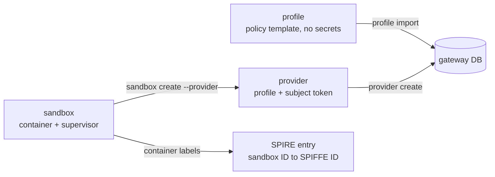
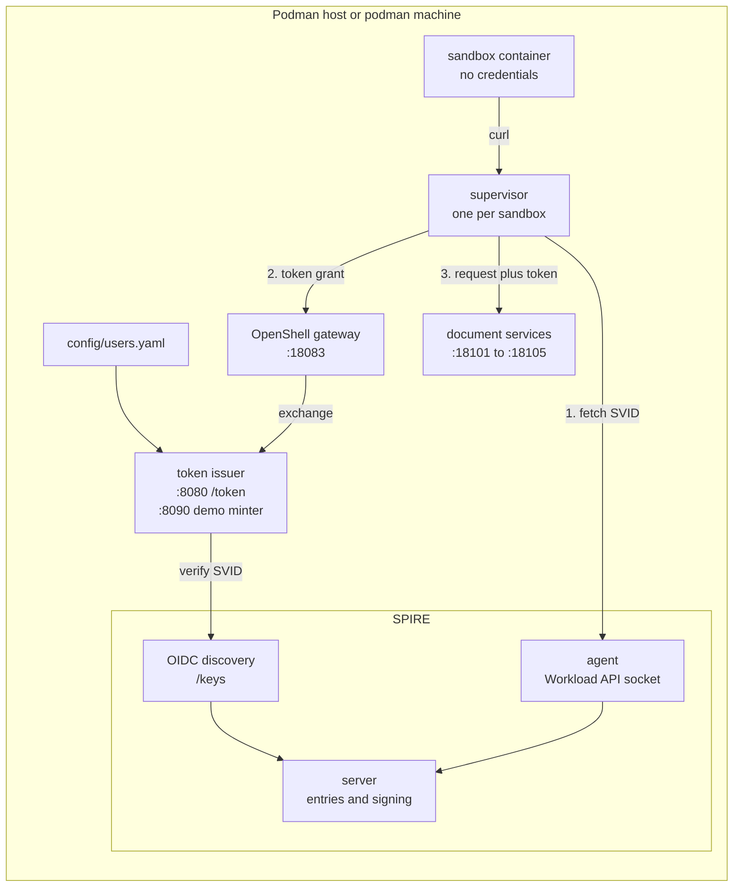
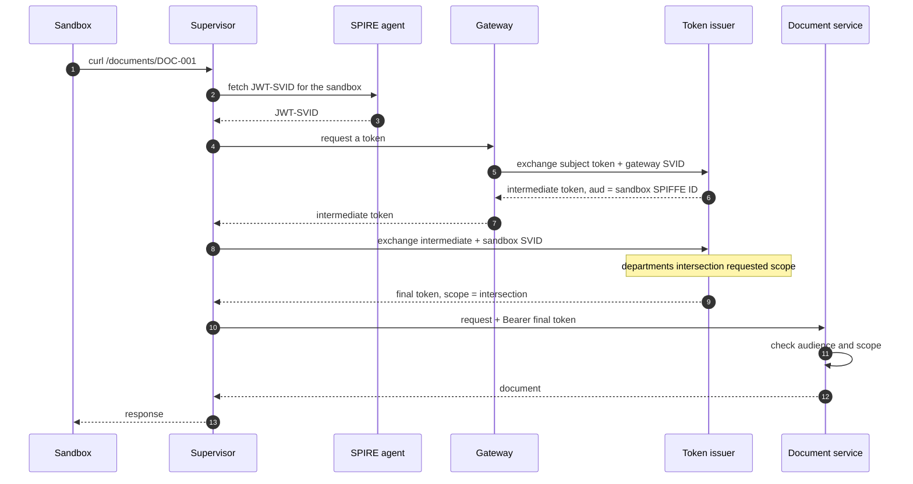
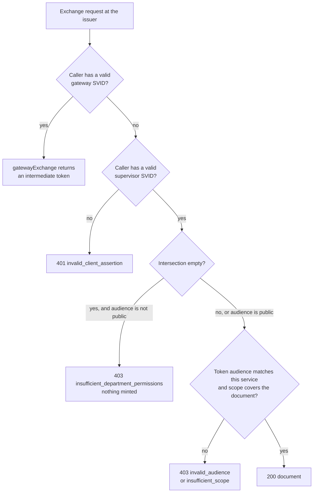

# Demo walkthrough

A hands-on walkthrough of the zero-trust agent demo: who is configured
where, how a sandbox starts, where each token comes from, and where the
access decisions are made. It complements `docs/ARCHITECTURE.md` (design)
and `docs/LEARNING_GUIDE.md` (security ideas) with the runtime details
you need to explain the demo to other people.

Two companion walkthroughs cover the later additions:
`docs/DEMO_WALKTHROUGH_A2A.md` for agent-to-agent calls and
`docs/DEMO_WALKTHROUGH_OPENSHIFT.md` for the Kubernetes driver.

Status: written against the Podman path on macOS (podman machine), 2026-11-04.

## Mental model: three layers

The demo separates three questions that are easy to conflate:

| Layer | Question | Configured in | Runtime artifact |
| ----- | -------- | ------------- | ---------------- |
| Human identity | Who is the user? | `config/users.yaml` | subject token, `sub` + `departments` |
| Capability | What may the agent do? | provider profile (`deploy/podman/profiles/*.yaml.in`) | scopes and audience in the token grant |
| Workload identity | Which process is acting? | SPIRE registration entry | SPIFFE SVID for the sandbox |

"Launching a sandbox as Alice with engineering capability" means storing
Alice's subject token in a provider whose profile requests the
`engineering` scope, then creating a sandbox from that provider.

## Object model



| Object | Created by | Lives in | Holds |
| ------ | ---------- | -------- | ----- |
| Profile | `openshell profile import` | gateway database | credential schema, token-grant policy, endpoints. No secrets. |
| Provider | `openshell provider create --type <profile-id> --credential ...` | gateway database | an instance of the profile plus the user's subject token |
| Sandbox | `openshell sandbox create --provider <name>` | podman container plus supervisor | the untrusted workload |
| SPIRE entry | `deploy/podman/spire/register-sandbox.sh` | SPIRE server | selector-to-SPIFFE-ID mapping |

The profile is policy, the provider is delegation, the sandbox is the
workload. The sandbox image is deliberately bare (`curlimages/curl`); it
holds no credentials and performs no token logic.

## Components



| Component | Role |
| --------- | ---- |
| Token issuer | Mints subject tokens, performs both RFC 8693 exchanges, verifies SPIFFE JWT-SVIDs. Enforces the permission intersection. |
| Document service | One per department. Validates the final token's audience and scope. |
| SPIRE server | Trust-domain authority: registration entries, signing keys, datastore. |
| SPIRE agent | Attests workloads locally and brokers SVIDs through the Workload API socket. |
| OIDC discovery provider | Publishes the server's JWT-SVID verification keys as standard OIDC/JWKS. It does not sign or mint tokens, but the issuer depends on it to verify SVIDs before any exchange. |
| OpenShell gateway | Holds providers and subject tokens; performs the intermediate exchange. |
| Supervisor | Injected beside each sandbox; fetches the sandbox SVID, requests tokens, injects the final token, proxies traffic. |

### SPIRE server, agent, and OIDC provider

```text
ISSUANCE                                      VERIFICATION
workload -> agent (Workload API socket)       token issuer -> OIDC provider -> /keys
            attests the workload  -> server   JWKS for JWT-SVIDs
```

- The workload never talks to the server directly; it asks the local
  agent. The agent collects selectors, matches a server-side entry, and
  gets the SVID signed.
- The server owns policy (entries) and signing. Registration is done
  through its admin API socket.
- The OIDC provider exists so external verifiers can validate JWT-SVID
  signatures without embedding keys. In this demo the issuer reads
  `SPIRE_JWKS_URI` and expects the matching issuer URL.

## Audience versus scope

Both use department names in this demo, but they answer different
questions:

| | Scope | Audience |
| --- | ----- | -------- |
| Question | What may the bearer do? | Who is this token for? |
| Enforced at mint | empty intersection gives `403 insufficient_department_permissions` (except `public`) | not checked as entitlement |
| Enforced at use | document's required department gives `403 insufficient_scope`; list responses omit unauthorized documents | must name this department, otherwise `403 invalid_audience` |

A profile for Alice with `audience: engineering` and `scopes: [hr]`
means "mint a token for the engineering service that asks for hr
capability". Scenario 2 keeps the destination fixed and changes only
the capability, isolating the intersection check.

The issuer does not check whether the user is entitled to the audience;
it checks that the audience is a known department, then intersects the
requested scope with the user's server-side departments. Audience is
recipient binding; scope is authorization. Scenario 6 demonstrates the
difference: a correctly scoped token is still rejected by the wrong
service because its `aud` names another department.

### Why both checks are needed

The intersection and the audience check cover different failure modes:

| Control | Prevents | Evidence |
| ------- | -------- | -------- |
| Intersection at mint | A caller inflating scope beyond the user's departments | Scenario 2 |
| Intermediate audience | Another sandbox reusing the delegation | Intermediate `aud` |
| Final audience | Replaying a valid token at another service | Scenario 6 |
| Resource scope check | Using a token for a document beyond its scope | `DOC-005` |

Audience is a restriction, not a grant: it narrows where a token may be
used. The issuer does not check whether the user is entitled to the
audience because the resource server enforces it, and the intersection
guarantees the capability is real. If the issuer copied the requested
scope verbatim instead of intersecting, it would become a scope
amplifier: any caller who can perform the final exchange could ask for
`scope=admin` and receive it.

## Token flow



### The three tokens

| Token | Minted by | Presented by | `aud` | `scope` | Distinguishing claims |
| ----- | --------- | ------------ | ----- | ------- | --------------------- |
| Subject | demo minter | gateway, to the issuer | `openshell-gateway`, `account` | `openid profile email` | `sub`, `departments`, `demo_token_use=user_subject` |
| Intermediate | issuer | supervisor, to the issuer | sandbox SPIFFE ID | copied from subject | `azp=gateway SVID`, `demo_token_use=intermediate` |
| Final | issuer | supervisor, to the document service | department, `account` | the intersection | `azp=supervisor SVID`, `demo_token_use=final` |

Why three tokens instead of one:

- The gateway holds the long-lived user token; the supervisor proves the
  workload identity. Neither can complete the delegation alone.
- The intermediate audience is the supervisor's SPIFFE ID, so it is
  bound to exactly one sandbox.
- The intermediate carries no capability; its scope is still the generic
  OIDC scope. Capability first appears in the final token, after the
  intersection succeeds.
- `demo_token_use` is a branch discriminator: a token minted for one
  exchange step cannot be replayed in another.
- The issuer re-reads the user's departments from `config/users.yaml` by
  `sub` instead of trusting the subject token's claim.

## The simulated IdP

`GET :8090/demo-subject-token?user=alice` is the demo's stand-in for a
human IdP. In production, Alice authenticates to Keycloak, Entra ID, or
Okta, and the resulting OAuth2 access token is stored in the provider.
The demo fabricates that token from `config/users.yaml` with no
authentication.

The listener split is deliberate:

| Listener | Endpoint | Reached by | Publication |
| -------- | -------- | ---------- | ----------- |
| `:8080` | `POST /token` | gateway, supervisors, scenario curls | loopback; plus LAN on Linux |
| `:8090` | `GET /demo-subject-token` | the laptop, and containers on the `zt2` network | host publish is loopback-only; the listener binds all interfaces inside the container |

If the minter shared `:8080`, publishing the authenticated endpoint
would also publish "mint a token as any user". On OpenShift the minter
is reachable only through `oc port-forward`, never a Route or Service.

Host publication and container-network reachability are different
things. The host port is bound to `127.0.0.1`, but the issuer container
joins the shared `zt2` network and its demo listener binds `:8090` on
all interfaces, so any container on that network can reach the minter.
The demo treats the podman network as trusted; do not copy this endpoint
into a deployment where untrusted workloads share a network.

Subject token claims:

| Claim | Meaning |
| ----- | ------- |
| `iss` | the demo issuer |
| `sub` | the user; authoritative departments are looked up by this value |
| `aud` | `openshell-gateway`, `account`; intended for the gateway exchange |
| `scope` | generic OIDC scopes, deliberately not the capability |
| `departments` | realistic IdP attribute, used for teaching; not trusted at mint |
| `demo_token_use` | `user_subject`, the exchange branch discriminator |
| `exp` | 30 minutes; scenarios mint a fresh token each run |

The demo signs with ES256 and publishes the verification keys at
`/.well-known/jwks.json`; the document services verify against that
JWKS and never hold signing material.

## The three access decisions



| Checkpoint | Where | Decision |
| ---------- | ----- | -------- |
| Workload identity | `token-issuer/server.go`, `handleToken` | The client assertion must verify as a gateway or supervisor SVID under the registered prefix. |
| Capability | `token-issuer/server.go`, `handleSupervisorExchange` | `user.departments` intersected with the requested scope must be non-empty, except for `audience=public`, which mints an empty scope; otherwise the minted scope is exactly the intersection. |
| Resource policy | `document-service/server.go`, `authenticate` and `hasScope` | The final token's `aud` must name this department, and its scope must cover the document's required departments. |

The gateway branch also requires `demo_token_use=user_subject` and
returns an intermediate token; the supervisor branch requires
`demo_token_use=intermediate` and performs the intersection.

The `public` audience is the one exception to the non-empty rule: an
empty intersection is allowed, and the final token carries an empty
scope. The public document service requires no department, so its
resource check still passes, but only for public documents.

The first two are mint-time decisions; the third is defense in depth.
This is v2's headline difference from v1, which enforced the same
intersection with OPA at request time.

## Running it by hand

### Preflight

Requirements: a running podman machine, openshell 0.1.8, Go 1.22+, openssl,
curl, python3. Build the demo container images if they are missing:

```bash
deploy/podman/scripts/build-images.sh
```

`make build` only produces host binaries; the demo runs the images above.
A fresh clone needs `build-images.sh` even though the README quick start
does not mention it yet.

### What setup creates

| Phase | Creates |
| ----- | ------- |
| 1 | SPIRE server, agent, OIDC discovery provider |
| 2 | OpenShell gateway container and its SPIFFE entry |
| 3 | token issuer and five document services |
| 4 | rendered profiles, linted and imported into the gateway |
| 5 | a smoke-test provider for Alice (`alice-eng`) |

Run it with:

```bash
scripts/setup.sh
```

The smoke provider proves that profile import and provider creation work.
It stops short of a sandbox; scenarios create their own providers so they
stay independently runnable and always use a fresh subject token.

### Walk through scenario 1 manually

Run these from the repository root; adjust the placeholder path.

```bash
cd /path/to/zero-trust-agents-v2
OS=(openshell --gateway zt2 --gateway-endpoint http://127.0.0.1:18083)
TOKEN=$(curl -fsS "http://127.0.0.1:8090/demo-subject-token?user=alice" \
  | python3 -c 'import json,sys; print(json.load(sys.stdin)["access_token"])')
```

Create a provider with Alice's delegation:

```bash
"${OS[@]}" sandbox delete walkthrough-s1 >/dev/null 2>&1 || true
for _ in $(seq 1 20); do
  "${OS[@]}" sandbox get walkthrough-s1 >/dev/null 2>&1 || break
  sleep 3
done
if "${OS[@]}" provider get walkthrough-eng >/dev/null 2>&1; then
  "${OS[@]}" provider delete walkthrough-eng
fi
"${OS[@]}" provider create --name walkthrough-eng \
  --type zt2-alice-engineering-v2 \
  --credential "subject_token=$TOKEN"
```

Create the sandbox. `sandbox create` runs the bootstrap command attached,
so background it and poll for readiness:

```bash
nohup "${OS[@]}" sandbox create --name walkthrough-s1 \
  --from docker.io/curlimages/curl:latest \
  --provider walkthrough-eng --keep --no-tty -- sleep infinity \
  > /tmp/walkthrough-s1.log 2>&1 < /dev/null &
disown
for i in $(seq 1 60); do
  OUT=$("${OS[@]}" sandbox get walkthrough-s1 2>/dev/null || true)
  ID=$(awk '/Id:/ {print $2; exit}' <<<"$OUT")
  PHASE=$(awk '/Phase:/ {print $2; exit}' <<<"$OUT")
  [[ -n "$ID" && "$PHASE" == "Ready" ]] && break
  sleep 2
done
if [[ -z "$ID" || "$PHASE" != "Ready" ]]; then
  printf "sandbox did not become ready; see /tmp/walkthrough-s1.log\n" >&2
  exit 1
fi
echo "sandbox id: $ID"
```

Register the sandbox's SPIFFE identity and inspect the entry:

```bash
TRUST_DOMAIN=openshell.local SPIRE_SERVER_CONTAINER=zt2-spire-server \
  bash deploy/podman/spire/register-sandbox.sh "$ID"
sleep 3
podman exec zt2-spire-server /opt/spire/bin/spire-server entry show \
  -socketPath /run/spire/server/private/api.sock \
  -spiffeID "spiffe://openshell.local/openshell/sandbox/$ID"
```

Make the request:

```bash
"${OS[@]}" sandbox exec --name walkthrough-s1 --no-tty -- \
  curl -sS --max-time 20 \
  "http://192.168.127.254.nip.io:18101/documents/DOC-001"
```

### What to observe

- The sandbox and supervisor both carry `openshell.ai/sandbox-id`, but
  only the supervisor mounts the Workload API socket. The socket, not
  the label match, is what lets the supervisor fetch the SVID.
- `provider get walkthrough-eng` shows the credential key but never its
  value. The gateway log explicitly refuses to inject `subject_token`
  into the sandbox environment.
- The supervisor logs almost nothing on success. The exchange is visible
  in the gateway logs:

```bash
podman logs zt2-gateway 2>&1 \
  | grep -i "ExchangeProviderSubjectToken\|non-injectable"
```

Clean up:

```bash
"${OS[@]}" sandbox delete walkthrough-s1
for _ in $(seq 1 20); do
  "${OS[@]}" sandbox get walkthrough-s1 >/dev/null 2>&1 || break
  sleep 3
done
"${OS[@]}" provider delete walkthrough-eng
```

### Decoded tokens in scenario output

Scenarios 1, 2, 5, and 6 print decoded JWTs at the points where tokens exist:

| Scenario | Decoded tokens | Teaching point |
| -------- | -------------- | -------------- |
| 1 | subject | identity and attributes, not capability; the final token is injected by the supervisor and never visible |
| 2 | subject, intermediate | the intermediate has no `hr` scope and no departments |
| 5 | rogue SVID | the SPIFFE ID the issuer prefix-checks is outside the supervisor path |
| 6 | intermediate, final | capability appears only in the final token |

Scenario 1 also prints a note that the sandbox never sees the final
token. Scenario 3 has no subject token at all, and scenario 4 never
exposes the final token.

### What the decoded tokens show

These are the claims the scenario output makes visible; they are the
fastest way to explain the chain without reading code.

| Token | Key claims | What the claims show |
| ----- | ---------- | -------------------- |
| Subject (scenario 2) | `sub: alice`, `departments: [engineering, finance]`, `scope: openid profile email` | identity and attributes, not capability |
| Intermediate (scenario 2) | `aud: [sandbox SPIFFE ID]`, `scope: openid profile email`, no `departments` | delegation is audience-bound and carries no capability |
| Rogue SVID (scenario 5) | `alg: ES256`, `sub: spiffe://openshell.local/rogue/workload/1`, `iss: http://spire-oidc:8080` | the SPIFFE ID the issuer prefix-checks; the 401 shows the assertion was refused |
| Final (scenario 6) | `aud: [engineering, account]`, `scope: engineering`, `azp: supervisor SPIFFE ID` | capability appears only after the intersection |

Decoding is not verification: `decode_jwt` only reads the header and
payload. The rogue SVID is known to be SPIRE-issued because it was
fetched from the SPIRE agent; the scenario's 401 is what shows the
issuer refused the assertion.

The first run of scenario 5 originally failed here: `fetch_rogue_svid`
captured the registration script's stdout along with the token, producing
a 704-character value instead of 397. Redirecting the registration output
fixed it. The decoder now reports a clear error instead of a Python
traceback when a segment is not a JWT.

### Scenario 2 end to end

Scenario 2 is the clearest single demonstration of mint-time denial:

1. Alice's subject token carries `departments: [engineering, finance]`.
2. The `alice-hr` profile requests `scopes: [hr]` with `audience: engineering`.
3. The issuer mints the intermediate token with `aud` set to the sandbox
   SPIFFE ID, `scope: openid profile email`, and no departments claim.
4. The supervisor requests the final token with `audience=engineering` and `scope=hr`.
5. The issuer intersects `{engineering, finance}` with `{hr}`, gets the
   empty set, and returns `403 insufficient_department_permissions`. No
   final token is minted.
6. The supervisor's proxy reports `502` to the sandbox because it has no
   token to inject. The document service is never contacted.

The script's direct issuer call is what exposes the `403` behind the
proxy's `502`.

## Gotchas found during the walkthrough

| Symptom | Cause | What to do |
| ------- | ----- | ---------- |
| Setup fails at `start-services.sh` on a fresh clone | `make build` does not build the demo images | Run `deploy/podman/scripts/build-images.sh` |
| First sandbox request returns 502 | The SPIRE entry has not reached the agent's cache, and the supervisor caches the failed grant | Wait after registration; `register_sandbox` in `scripts/drivers/lib-podman.sh` sleeps 3 seconds |
| Supervisor logs are empty on success | Only warnings are logged at the default level | Check the gateway logs for `ExchangeProviderSubjectToken` |
| `provider get` shows no secret | Credentials are stored encrypted and never injected | Expected; the sandbox must not see the user token |
| Both sandbox and supervisor match the SPIRE entry | Selectors do not include `isolation-role` | Only the supervisor has the Workload API socket |
| Background `sandbox create` reports `suspended (tty input)` | The job inherited the terminal as stdin | Add `< /dev/null` and `disown` |
| Container name contains `default` | It is the workspace, not the driver | Name format is workspace, namespace, sandbox name, ID |
| OIDC `:8008` health endpoints are unreachable | Not published and no healthcheck is configured | Readiness is checked on `/keys`, a stronger signal |
| No `compute_driver` in the OpenShift values | The Helm chart supplies the Kubernetes driver | Verify with `helm show values` or the rendered StatefulSet |
| Scenario 5 behaves differently on OpenShift | The attestation policy refuses to mint the rogue SVID | That is the pass condition on Kubernetes |
| Decoding the rogue SVID fails on the first run | Registration stdout was captured along with the token | Fixed in `fetch_rogue_svid`; re-running after the entry exists also worked around it |
| The minter is reachable from other containers | Host publish is loopback-only, but the listener binds all interfaces on the `zt2` network | The demo treats that network as trusted; remove or isolate the endpoint before production |

## Scenario matrix

| # | User | Capability | Target | Result | What it proves |
| - | ---- | ---------- | ------ | ------ | -------------- |
| 1 | Alice | engineering | engineering doc | allow | full exchange chain |
| 2 | Alice | hr | engineering doc | deny | intersection at mint time |
| 3 | none | engineering | engineering doc | deny | no delegation, nothing to exchange |
| 4 | Carol | hr | hr doc | allow | matrix is data-driven |
| 5 | rogue | none | any | deny | workload identity is the root of trust |
| 6 | Alice | engineering | finance doc | deny | audience binding stops replay |

## Glossary

| Term | Meaning |
| ---- | ------- |
| Subject token | The user's OAuth2 access token, held by the gateway. |
| Intermediate token | Gateway-to-supervisor delegation, audience-bound to one sandbox. |
| Final token | Scoped access token presented to a document service. |
| Provider profile | Policy template: credentials, token grant, endpoints. |
| Provider | A profile instance with a real credential value. |
| SVID | SPIFFE Verifiable Identity Document, issued by SPIRE. |
| Workload API | The Unix socket through which a workload requests its SVID. |
| Intersection | `user.departments` intersected with the requested scope. |

## Next steps

- Exercise the three checkpoints directly: run `scripts/scenario2.sh`
  and compare the 502 at the proxy with the 403 from the issuer.
- Run scenarios 2 and 6 and compare the decoded tokens: scenario 2 shows
  an intermediate with no capability, and scenario 6 shows the final
  token with `scope: engineering` and `aud: engineering`.
- Read `docs/DEMO_SCENARIOS.md` for the adversarial scenarios and
  `docs/PRODUCTION_RECOMMENDATIONS.md` before presenting to customers.
