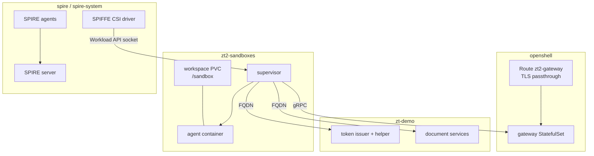
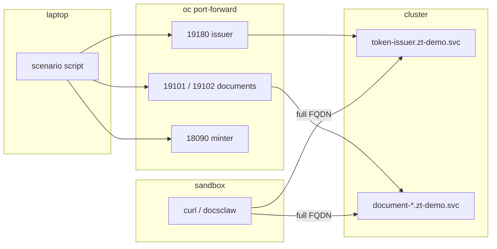
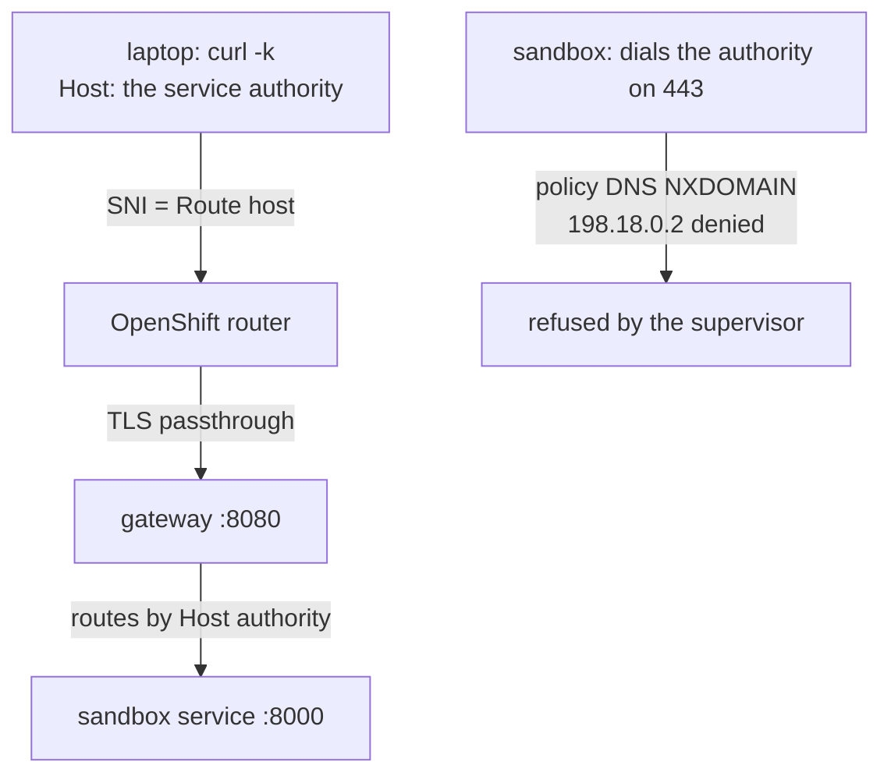

# OpenShift walkthrough

A hands-on walkthrough of running the demo on OpenShift: what the driver
changes, what `setup.sh` builds in the cluster, how a sandbox and its SVID
appear, and which addresses a scenario uses from the laptop versus from
inside a sandbox. It complements `docs/DEMO_WALKTHROUGH.md` (the runtime
model, which is identical) and `docs/DEMO_WALKTHROUGH_A2A.md` (the
agent-to-agent layer).

Status: verified on ROSA 4.22 (amd64), 2026-11-11. Scenarios 1–6, 12, 13
and 14 pass under `ZT2_DRIVER=openshift`; 11 and 15 are blocked by an
upstream exposure limitation described below.

## The driver abstraction

The scenario scripts are driver-neutral. Everything backend-specific lives
in `scripts/drivers/lib-${ZT2_DRIVER}.sh`, and `setup.sh` writes the values
the driver needs into `$STATE_DIR/openshift.env`.

```bash
deploy/openshift/build-images.sh        # build and push the v2 images
ZT2_DRIVER=openshift deploy/openshift/setup.sh
ZT2_DRIVER=openshift scripts/scenario1.sh
```

| Concern | Podman driver | OpenShift driver |
| ------- | ------------- | ---------------- |
| Gateway address | `127.0.0.1:18083` | `https://<gateway Route>` |
| Sandbox lifecycle | container plus supervisor | Agent Sandbox CR plus supervisor pod |
| Workload identity | SPIRE entry per sandbox | ClusterSPIFFEID via pod attestation |
| Workspace | `/workspace` | `/sandbox` (a PVC) |
| Host-side access | published loopback ports | `oc port-forward` on the `191xx` block |

## What `setup.sh` creates

The script is idempotent and runs in seven phases. On a fresh cluster it
takes several minutes.

| Phase | Creates |
| ----- | ------- |
| 1 | SPIRE: CRDs, server, agents, OIDC discovery, SPIFFE CSI driver |
| 2 | Agent Sandbox controller and the `sandboxes.agents.x-k8s.io` CRD |
| 3 | OpenShell gateway StatefulSet, its `openshell` namespace and a TLS-passthrough Route |
| 4 | Token issuer (with a `spiffe-helper` sidecar) and five document services, plus a default-deny NetworkPolicy |
| 5 | A `oc port-forward` to the loopback-only subject-token minter |
| 6 | Gateway registration (`--local` mTLS with the chart's client bundle) and the profiles |
| 7 | A smoke provider for Alice, then writes `openshift.env` |

The namespaces are `openshell` (gateway), `zt-demo` (issuer and document
services) and `zt2-sandboxes` (sandboxes). Sandboxes deliberately do not
live beside the gateway: the gateway's ClusterSPIFFEID is scoped to its
namespace, and co-locating them would hand every sandbox a gateway-prefix
SVID.

## Cluster topology



Every sandbox request leaves through its supervisor, which is why the
gateway and the services only ever see the supervisor's address, not the
agent's.

## Identity in the cluster

There is no `register-sandbox.sh` on Kubernetes. The SPIFFE CSI driver
mounts the Workload API socket into the supervisor, and a ClusterSPIFFEID
mints the identity from pod attestation. The sandbox and its supervisor
resolve to the same SPIFFE ID, `spiffe://openshell.local/openshell/sandbox/<id>`;
only the supervisor mounts the socket, which is what lets it fetch tokens.

The gateway's own SVID is fetched for scenarios 2 and 6 by a helper pod
that runs as the gateway's ServiceAccount, so the identity is attested the
same way any workload's is.

## Addresses: laptop versus sandbox

A single scenario uses both, and mixing them up is the most common
mistake. The laptop reaches services through port-forwards; a sandbox
reaches them through cluster DNS.

| Destination | From the laptop | From inside a sandbox |
| ----------- | --------------- | --------------------- |
| Token issuer | `http://127.0.0.1:19180` | `http://token-issuer.zt-demo.svc.cluster.local:8080` |
| Document service | `http://127.0.0.1:19101` (engineering), `:19102` (finance) | `http://document-<dept>.zt-demo.svc.cluster.local:8080` |
| Subject-token minter | `http://127.0.0.1:18090` | not reachable; the listener is port-forward only |
| Gateway (CLI) | `https://<gateway Route>` | `https://openshell.openshell.svc.cluster.local:8080` |

Two rules follow from this:

- **Full FQDNs inside sandboxes.** The sandbox resolver has no search
  domains, so short `.svc` names do not resolve.
- **Distinct host ports.** The OpenShift driver uses its own block
  (`19180`, `19101`, `19102`) so a laptop that is also running the Podman
  demo cannot silently route a scenario into the wrong stack.



## The JWKS path

The token issuer publishes `/.well-known/jwks.json` on its main listener.
Two consumers reach it differently:

- Document services fetch it via `ACCESS_TOKEN_JWKS_URL`, the short
  `http://token-issuer.zt-demo.svc:8080/.well-known/jwks.json` (same
  namespace, search domain applies).
- Agent B fetches it through its own supervisor, so its profile names the
  `…/.well-known/jwks.json` FQDN as a read-only endpoint. Agent B's
  `inbound_auth.issuer` stays the literal `http://token-issuer.zt-demo.svc:8080`
  because the issuer claim must match exactly.

## The workspace path

The Kubernetes driver mounts the sandbox's writable workspace PVC at
`/sandbox`. The image's `/workspace` is the read-only container rootfs, so
anything written there fails with `EACCES` while `/sandbox` succeeds.

```text
uid=1000870000 …            # SCC-assigned, not the image's 1001
touch /tmp/x      → OK
touch /sandbox/x  → OK
touch /workspace/x → Permission denied
```

The driver therefore reports `WORKSPACE_DIR=/sandbox`, and the harness
uploads agent configs there, runs `docsclaw serve --config-dir
/sandbox/agent`, and renders `tools.workspace` to the same value. A
follow-up to make `/sandbox` exist in the image (so both drivers can use
one path) is tracked in `redhat-et/docsclaw#130`.

## Exposed services and how to call them

`service expose` returns a URL, but not one you can dial as written:

```text
URL: https://default--eng-analyst--agent.openshell.localhost/
```

That is a `*.openshell.localhost` authority with no port and no Route. It
is not resolvable from the laptop (nothing listens on `127.0.0.1:443`) and
not resolvable inside a sandbox either.

The working form from the laptop is the gateway Route with the service
authority as `Host`. The router selects the Route by SNI, then the gateway
routes by HTTP authority:

```bash
curl -k -H 'Host: default--eng-analyst--agent.openshell.localhost' \
  https://<gateway Route>/health
```



Scenarios use the driver helper `service_curl`, which does exactly this.
That is what lets scenario 13 (`401 missing_token`) and scenario 14
(`403 invalid_audience`) pass on OpenShift.

From inside a sandbox the same call is refused. The supervisor's policy
DNS forwards `*.openshell.localhost` upstream, which answers NXDOMAIN, and
the synthetic address it stages is then denied:

```text
DENIED default--eng-analyst--agent.openshell.localhost [reason:policy_dns_upstream_no_data]
DENIED /usr/bin/curl(0) -> 198.18.0.2:443 [reason:transparent_tcp_policy_denied]
```

On Podman the same class of problem is solved with a host-published relay
(`openshell forward`). The OpenShift driver's `start_relay` is a no-op and
there is no in-cluster equivalent, so scenarios 11 and 15 — which need
A to reach B — cannot run yet. This is recorded as a gap, not worked
around. Scenario 12 does not need A to reach B: its undeclared hr peer is
denied by A's supervisor before egress, so it runs and passes.

## Images

The cluster is amd64, so both image sources must be real amd64 builds.

| Image | How it is produced |
| ----- | ------------------ |
| `quay.io/panni/zt2-{token-issuer,document-service}:v2` | `deploy/openshift/build-images.sh` on the rhel homelab |
| DocsClaw agent image | `make image-openshell OPENARCH=amd64` from the DocsClaw checkout, with a multi-arch base |

The DocsClaw image needs care: the historical `-openshell-amd64` tag was a
mislabeled arm64 image (fails with `Exec format error`), and the driver
pulls sandbox images with `if_not_present`, so a rebuilt image under the
same tag is not re-pulled. Publish a fresh tag and point `DOCSCLAW_IMAGE`
at it. `Containerfile.openshell` currently pins a single-arch arm64
`ubi-minimal` digest, so an amd64 build fails at `microdnf install -y tar`;
switch it to the multi-arch `ubi10/ubi-minimal:latest` index until
redhat-et/docsclaw#131 lands.

## Running the scenarios

Start with the base six; they are the entry condition for everything else.

```bash
ZT2_DRIVER=openshift scripts/scenario1.sh    # ... through scenario6.sh
ZT2_DRIVER=openshift scripts/scenario13.sh
ZT2_DRIVER=openshift scripts/scenario14.sh
```

Scenarios 11 and 12 need `LLM_API_KEY`, `LLM_BASE_URL` and `LLM_MODEL` and
exit 2 without them; 13, 14 and 15 run without a model. `LLM_BASE_URL` is
the OpenAI-compatible base **including** `/v1`: DocsClaw appends
`/chat/completions`, so a base without `/v1` gets a 503 from the gateway.

Two behaviours differ from Podman and are expected, not failures:

- Scenario 5 passes because SPIRE refuses to mint the rogue identity at
  all, which is stronger than the issuer-side 401 on Podman.
- Scenario 6 would silently reach a running Podman demo if the two drivers
  shared host ports; the `191xx` block exists to prevent that.

## Troubleshooting

| Symptom | Cause | Fix |
| ------- | ----- | --- |
| Sandbox stuck in `ConfigurationPending` | `openshell-client-tls` missing in `zt2-sandboxes` | Re-run `setup.sh`; it copies the secret |
| Sandbox pod `Init:ImagePullBackOff`, `unauthorized` | Private image and no pull secret in `zt2-sandboxes` | Make the repo public or add a pull secret |
| `Exec format error` spawning `sleep` | Arm64 or mislabeled image on an amd64 node | Rebuild for amd64 and use a fresh tag |
| `docsclaw serve` cannot write its log | Workspace path is `/workspace`, which is read-only | Use `/sandbox` (`WORKSPACE_DIR`) |
| Scenario sees a stale image after a rebuild | `if_not_present` pull policy on the node | Push a new tag |
| Scenario 6 reaches the wrong stack | OpenShift and Podman share a host port | Use the `191xx` block; bind `--address 127.0.0.1` |
| `401` at every exchange just after a rollout | Issuer still waiting for `SPIRE_JWKS_CA_FILE` | Wait a few seconds; it retries for 30 s |
| `auth error`/`transport error` from the CLI | Wrong Route host, or stale mTLS bundle | Check `openshift.env`; re-run `setup.sh` |
| Exposed URL unreachable | It is a `.openshell.localhost` authority | Use the Route with a `Host` header |

## Teardown

```bash
deploy/openshift/teardown.sh          # releases, namespaces, CLI state
deploy/openshift/teardown.sh --all    # also CRDs and agent-sandbox-system
```

For a short-lived cluster, expiry is the teardown.

## Next steps

- Run scenarios 1–6 first; a failure there is a cluster or image problem,
  not a policy result.
- Use `docs/DEMO_WALKTHROUGH_A2A.md` for the agent layer, and
  `docs/DEMO_SCENARIOS.md` for the per-scenario teaching points.
- Track the in-cluster A2A exposure gap before promising scenarios 11–15
  on Kubernetes.
